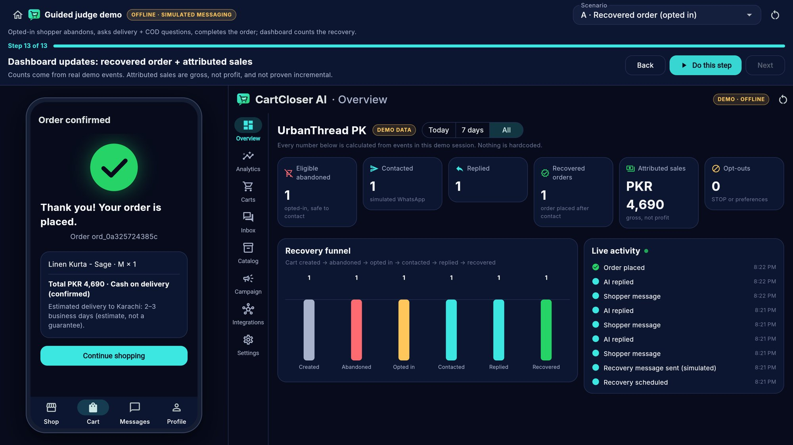
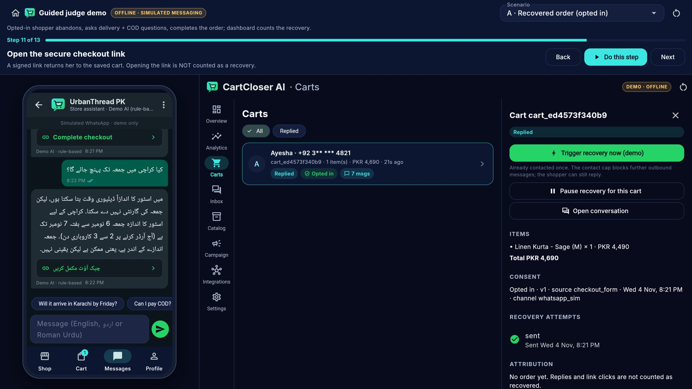
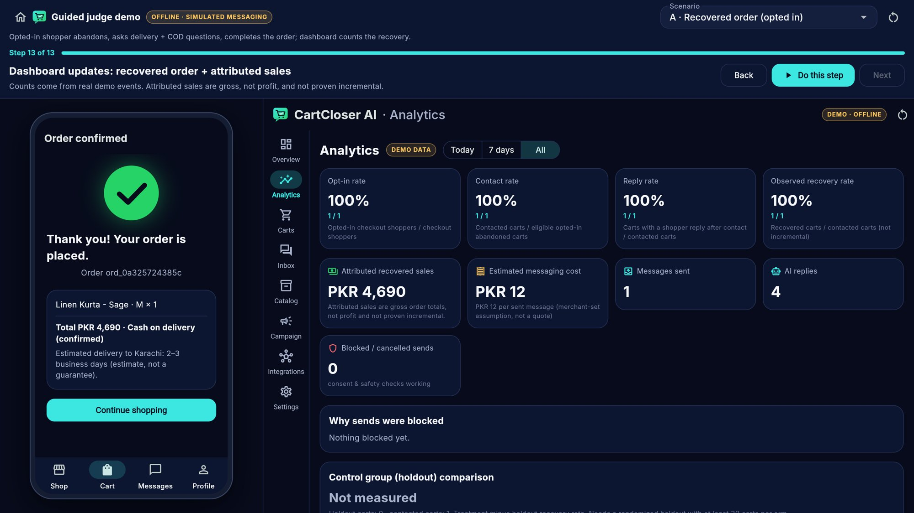
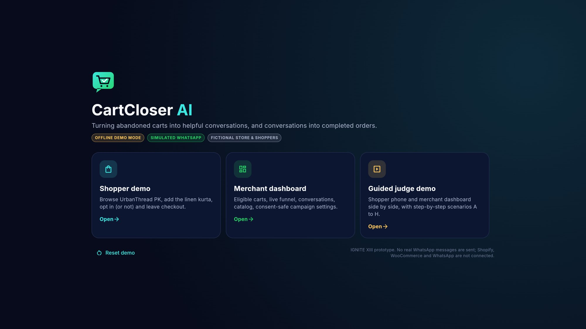
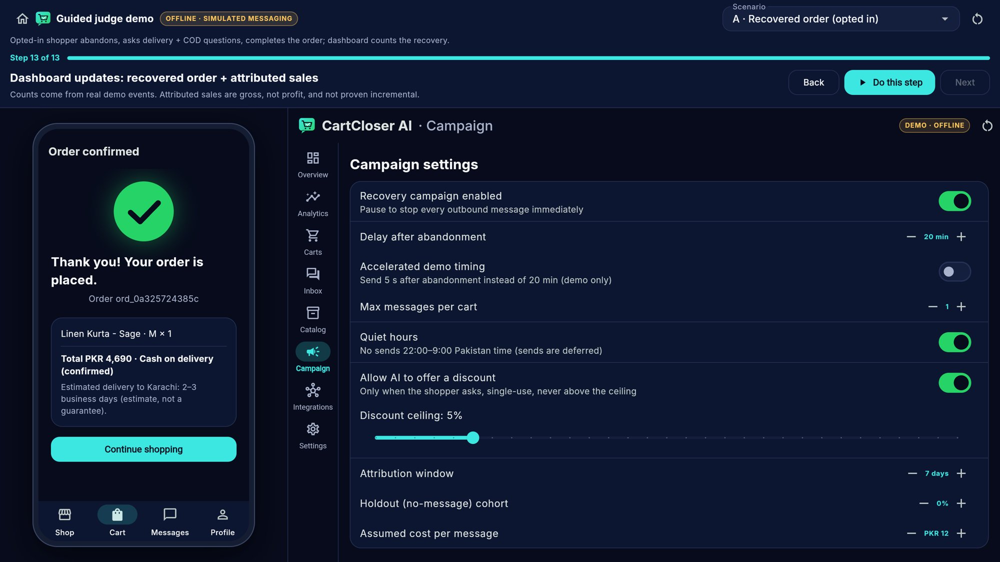
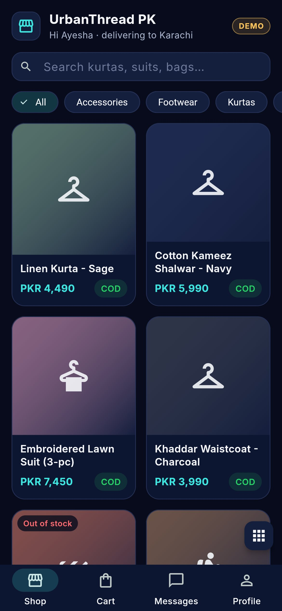

# CartCloser AI: working prototype (IGNITE XIII)

Consent-based abandoned-checkout recovery for Pakistani e-commerce merchants. A shopper browses the fictional **UrbanThread PK** store, leaves checkout, gets **one** simulated WhatsApp-style message (only if they opted in), asks about delivery / COD / size in **English, Urdu or Roman Urdu**, and completes the order. The merchant sees everything live in a dashboard whose numbers are calculated from real demo events.

**Live demo (GitHub Pages, runs fully in the browser):** <https://apex010110.github.io/Random/cartcloser/>
· Guided judge demo: <https://apex010110.github.io/Random/cartcloser/#/judge>
· Redeploy after changes: `./cartcloser-ai/scripts/deploy_pages.sh` (from the repo root)

> **Honest labels.** The store, products, prices, shoppers and policies are fictional. Messaging is a built-in simulator (not the WhatsApp app). Shopify, WooCommerce and the WhatsApp Business Platform are **not connected**. No payment data is collected.

| | |
|---|---|
| **Flutter app** | `flutter_app/`: Android, iOS, Web. Riverpod, go_router, Dio, fl_chart, Material 3. Runs fully **offline** by default |
| **Backend** | `backend/`: FastAPI, Pydantic 2, SQLAlchemy 2, Alembic, SQLite (demo) / PostgreSQL. SSE + polling live updates |
| **AI** | Deterministic grounded assistant (both engines) + optional server-side Claude rephraser (`AI_PROVIDER=anthropic`) |
| **Docs** | [architecture](docs/architecture.md) · [API](docs/api.md) ([openapi.json](docs/openapi.json)) · [demo script](docs/demo-script.md) · [security](docs/security.md) · [test report](docs/test-report.md) · [Green Logistics](docs/green_logistics.md) · [screenshots](docs/screenshots/) |

## Screenshots
| Guided judge demo (recovered) | Urdu delivery answer | Merchant analytics |
|---|---|---|
|  |  |  |
| **Welcome / roles** | **Campaign settings** | **Phone storefront** |
|  |  |  |

## Quick start: stage demo (no backend, no network)

**Web** (laptop):
```bash
cd flutter_app
flutter pub get
flutter run -d chrome                 # dev
# or a static build you can serve offline:
flutter build web --release --no-web-resources-cdn
python3 -m http.server 8080 --directory build/web    # open http://localhost:8080
```
**Android**: `flutter build apk --release` → `build/app/outputs/flutter-apk/app-release.apk` (install with `adb install`).

**iOS** (macOS + Xcode 16+ required). One command installs on your USB-connected iPhone, signed with your Apple team (free Apple ID works for 7-day installs; paid Developer Program for longer):
```bash
TEAM_ID=<your 10-char Team ID> BUNDLE_ID=com.yourname.cartcloser ./cartcloser-ai/scripts/ios_install_mac.sh
```
First time on the phone: enable *Settings → Privacy & Security → Developer Mode*, and after install trust the profile in *Settings → General → VPN & Device Management*.
CI also builds iOS on a GitHub-hosted Mac (`.github/workflows/cartcloser-ios.yml`): unsigned by default; add the `IOS_*` repo secrets listed in that file to get a signed `.ipa`, plus `ASC_*` secrets for TestFlight upload.

Then: **Welcome → Guided judge demo** and press **Do this step** repeatedly (scenario A, 13 steps). Pick scenarios **A–H** from the dropdown. The ↻ icon resets demo data.

## Backend (optional: LAN or cloud mode)

```bash
cd backend
python3 -m venv .venv && . .venv/bin/activate
pip install -r requirements-dev.txt
cp ../.env.example ../.env            # optional; defaults work
python -m app.cli migrate             # Alembic → SQLite file cartcloser_demo.db
python -m app.cli seed                # fictional UrbanThread PK tenant
uvicorn app.main:app --host 0.0.0.0 --port 8000
# Swagger UI: http://localhost:8000/docs
```
**Docker (PostgreSQL)**: `cp .env.example .env && docker compose up --build` → API on `:8000`.

**Phone → laptop over Wi-Fi**: run uvicorn with `--host 0.0.0.0`, find the laptop IP (`ipconfig` / `ip addr`), allow port 8000 in the firewall, then in the app **Merchant → Settings → Backend URL** `http://<laptop-ip>:8000` → *Test connection* → *Use backend*. If anything fails, switch back to *Offline demo*; it is always safe.

**Optional Claude rephrasing**: set `AI_PROVIDER=anthropic`, `ANTHROPIC_API_KEY=...` (server only; never in Flutter). Default model `claude-opus-5-5` (`AI_MODEL`). The LLM only rewrites facts the rules engine computed; any reply with new numbers or without the no-guarantee wording is discarded (see [security](docs/security.md)). Not exercised against the live API in this repo (no key here); covered with a stubbed client.

## Tests
```bash
cd backend && python -m pytest -q                       # 46 tests: scenarios A–H, units, security, LLM adapter
TEST_DATABASE_URL=postgresql+psycopg://... python -m pytest -q   # same suite on PostgreSQL
cd flutter_app && flutter analyze && flutter test       # 25 tests (1 needs CARTCLOSER_BACKEND): parity (384 fixtures), engine A–H, widgets, UI acceptance
CARTCLOSER_BACKEND=http://localhost:8000 flutter test test/api_repository_test.dart   # app ↔ live backend
flutter test integration_test/app_test.dart -d <device> # same acceptance flow on an emulator/simulator
```
Exact outputs: [docs/test-report.md](docs/test-report.md).

## What works / what is simulated / what is unfinished

**Works end-to-end (offline and with the backend)**
- Storefront (search, categories, PKR prices, stock, sizes), product detail (city delivery estimate, COD, exchange policy), cart (qty, promo `WELCOME5`, shipping), checkout with a **separate unchecked** WhatsApp opt-in, explicit *Leave checkout* abandonment.
- Eligibility at abandonment **and at send time**: consent, STOP/opt-out, under-18, already purchased, campaign/cart pause, contact cap, quiet hours (defer). Delay 20 min (accelerated 5 s option), demo "Trigger recovery now".
- Simulated inbox with typing dots, timestamps, quick replies, RTL Urdu, signed checkout links, opt-out action; on-site chat without consent.
- Grounded assistant: delivery windows (never guaranteed), COD rules, size/stock (no invented availability, alternatives), shipping fees, returns, capped single-use discounts, human handoff, prompt-injection refusal; English / Urdu script / Roman Urdu.
- Recovered checkout → COD confirmation → receipt; attribution window; idempotent orders/events.
- Merchant: overview KPIs (count-up), funnel chart, live activity, analytics with numerators/denominators and definitions, cart list/detail, inbox with confidence/handoff/takeover, catalog & policy editor, campaign settings, integrations (honest status), export & per-shopper deletion, reset.
- Guided judge demo: split view (phone + dashboard), scenarios A–H, next/back/reset, progress.

**Simulated**: WhatsApp delivery (in-app simulator), online payment ("demo", nothing collected), product images (placeholders), delivery estimates (fictional business-day windows).

### Green Logistics extension (new — see [docs/green_logistics.md](docs/green_logistics.md))

A failed-delivery-prevention module layered on top of the cart-recovery product above, **not a
replacement for it**. COD orders go through a pre-dispatch confirmation gate before a courier is
ever sent; a guarded fulfillment state machine (`pending_confirmation → hold/ready_to_dispatch →
dispatched → delivered/failed_attempt/returned/cancelled`) backs a 7-tab **Merchant → Orders**
screen, and a **Merchant → Green Logistics** dashboard shows observed confirmation/failed/return
rates plus illustrative, assumption-driven avoided-trip and CO2e estimates that show **no number at
all** until a merchant explicitly sets the assumption behind it. Size clarification reuses the
existing grounded assistant unchanged. **Proposed enhancement, not a validated environmental
result** — see the dashboard's own banner and the guardrails in the doc above.

**Not implemented / limitations**
- Shopify / WooCommerce: webhook endpoints verify HMAC and de-duplicate, but payload → cart mapping, OAuth install and app-store listing are **not built**.
- WhatsApp Business Platform adapter: **not built** (requires Meta verification, approved templates).
- Real merchant authentication, rate limiting, queue workers, monitoring (demo uses static tokens and an in-process scheduler).
- Guardian-authorization flow for minors (minors are simply excluded from outbound).
- Voice notes (text only). Offline engine state lives in memory (a browser refresh resets the demo; backend mode persists).
- Holdout lift is computed only with ≥30 carts per arm; in the demo it shows "Not measured".
- Docker image not built here (no Docker daemon in this environment); compose file is untested. Postgres path was verified with a local PostgreSQL 16.

## Build outputs
- **Android APK**: built here (`flutter build apk --release`, 60.4 MB, debug-signed for sideloading). Not committed to git (binary); rebuild with the command above. Install: enable "Install unknown apps", then open the APK or `adb install app-release.apk`.
- **Flutter web**: built here and browser-tested (`flutter_app/build/web`, not committed).
- iOS and Docker images were **not** built in this environment (no macOS / no Docker daemon).
- OpenAPI: [`docs/openapi.json`](docs/openapi.json), regenerate with `python -m app.cli openapi > ../docs/openapi.json`.
- Shared seed + parity: edit `seed/*.json`, then `./scripts/sync_seed.sh`.
